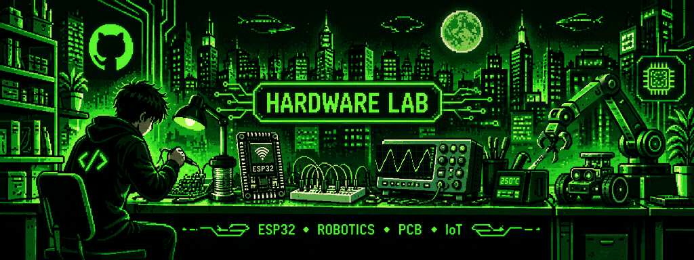
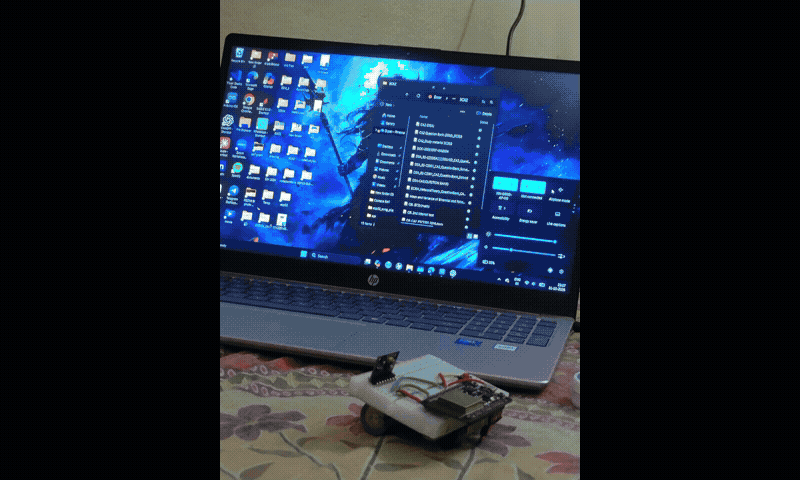

  

## Hi there 👋

## 🌐 Socials:
   

## 💸 Support My Work 🤝

If you've found my content helpful — tutorials, code, or videos — and want to say **thanks**, here are a few ways to support 💖:

### 💻 Tech Stack

---

### 🗣️ Languages

---

### 🔌 Embedded, Hardware & IoT

---

### 🤖 AI Systems, Edge AI & Computer Vision

---

### ☁️ IoT Cloud, Databases & Dashboards

---

### 🛠️ OS & Dev Tools

---

# 📊 GitHub Stats:
 
 

## 🏆 GitHub Trophies

### ✍️ Random Dev Quote

---

## 💰 You can help me by Donating

<!-- Proudly created with GPRM ( https://gprm.itsvg.in ) -->

---
<h2 align="center">📸 Project Memories</h2>

  

<picture>
  <source media="(prefers-color-scheme: dark)" srcset="https://raw.githubusercontent.com/dipanr705-12/dipanr705-12/output/github-snake-dark.svg">
  <source media="(prefers-color-scheme: light)" srcset="https://raw.githubusercontent.com/dipanr705-12/dipanr705-12/output/github-snake.svg">
  
</picture>
