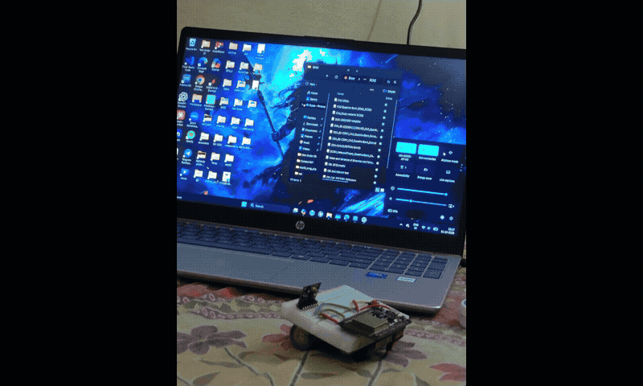

  

## Hi there 👋

## 🌐 Socials:
    

## 💸 Support My Work 🤝	

If you’ve found my content helpful — tutorials, code, or videos — and want to say **thanks**, here are a few ways to support 💖:

# 💻 Tech Stack:
      
# 📊 GitHub Stats:
 
 

## 🏆 GitHub Trophies

### ✍️ Random Dev Quote

---

  ## 💰 You can help me by Donating
   

  
<!-- Proudly created with GPRM ( https://gprm.itsvg.in ) -->
<!--
**dipanr705-12/dipanr705-12** is a ✨ _special_ ✨ repository because its `README.md` (this file) appears on your GitHub profile.

Here are some ideas to get you started:

- 🔭 I’m currently working on ...
- 🌱 I’m currently learning ...
- 👯 I’m looking to collaborate on ...
- 🤔 I’m looking for help with ...
- 💬 Ask me about ...
- 📫 How to reach me: ...
- 😄 Pronouns: ...
- ⚡ Fun fact: ...
-->

---

<h2 align="center">📸 Project Memories</h2>

  

<picture>
  <source media="(prefers-color-scheme: dark)" srcset="https://raw.githubusercontent.com/dipanr705-12/dipanr705-12/output/github-snake-dark.svg">
  <source media="(prefers-color-scheme: light)" srcset="https://raw.githubusercontent.com/dipanr705-12/dipanr705-12/output/github-snake.svg">
  
</picture>
